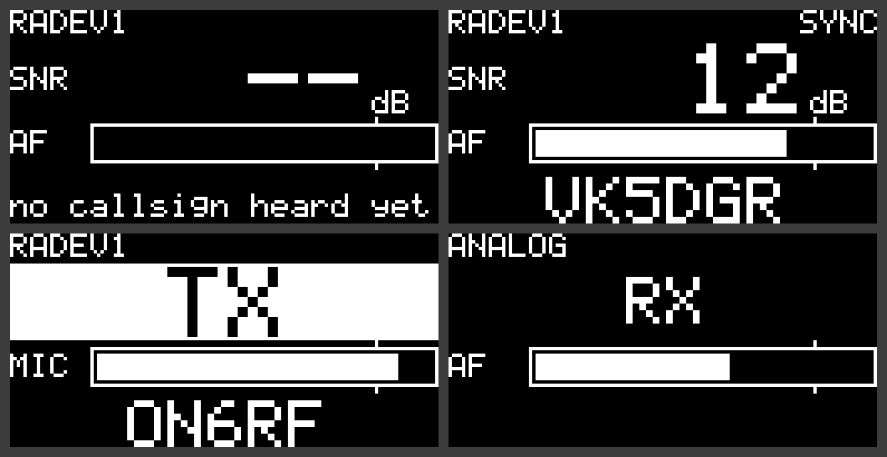

# freedv-embedded

A headless FreeDV modem for a Raspberry Pi. It sits between a radio and a
headset and adds RADE V1 to a radio that does not have it.

<p align="center">
  
</p>

<p align="center">
  The status screen on a two-colour SSD1306, receiving (left) and transmitting (right).
</p>

## Contents

- [What it does](#what-it-does)
- [How it works](#how-it-works)
- [Hardware](#hardware)
- [Build](#build)
- [Configure and run](#configure-and-run)
- [PTT](#ptt)
- [Analog mode](#analog-mode)
- [Display](#display)
  - [Wiring](#wiring)
  - [Enable I2C on the Pi](#enable-i2c-on-the-pi)
  - [What it shows](#what-it-shows)
  - [Refresh rate](#refresh-rate)
- [Logging](#logging)
- [Project layout](#project-layout)
- [Where the FreeDV code comes from](#where-the-freedv-code-comes-from)
- [Tests](#tests)
- [Status and next steps](#status-and-next-steps)

## What it does

- Encodes and decodes RADE V1 with the upstream FreeDV code, pulled in as a
  git submodule.
- Uses two sound cards: one for the radio, one for the headset.
- PTT from a GPIO line or from the keyboard. PTT out through the radio's VOX
  or a GPIO line.
- Analog mode: a switch bypasses the modem and passes audio straight through.
- Status on an SSD1306 OLED and on the console: SNR, AF level, sync, mode,
  callsign.
- One TOML config file. Unknown keys and bad values are reported as errors.

## How it works

```
 headset mic ──> [sound card 2] ──> TX: RADE encode ──> [sound card 1] ──> radio audio in
 headphones  <── [sound card 2] <── RX: RADE decode <── [sound card 1] <── radio audio out

 PTT button ──> GPIO in ──> PTT state machine ──> PTT out (radio VOX, or GPIO)
 mode switch ─> GPIO in ──┘       │
                                  └──> display (SNR, AF level, modem state, callsign)
```

In analog mode the two RADE boxes are bypassed.

Threads at run time: four audio threads (one per stream direction), the
backend's TX and RX threads, the display thread, and the control thread, which
polls PTT and the mode switch every 5 ms.

## Hardware

| Part | Notes |
|---|---|
| Raspberry Pi | Tried on a Pi 4 with the 64 bit Raspberry Pi OS |
| Sound card for the radio | Any ALSA device. USB cards work. |
| Sound card for the headset | Same |
| PTT button | Optional. A GPIO line, or the space bar for bench tests. |
| Mode switch | Optional. A push button or a latching switch on a GPIO line. |
| Display | Optional. 128x64 SSD1306 OLED on I2C, single or two-colour. |

## Build

The build needs network access. Opus, RNNoise and rade_c are downloaded the
first time, which takes a while.

```bash
sudo apt install build-essential cmake git autoconf automake libtool wget patch libasound2-dev libsamplerate0-dev libebur128-dev
```

```bash
git clone --recurse-submodules https://github.com/ManoDaSilva/freedv-embedded.git
```

```bash
cmake -S freedv-embedded -B freedv-embedded/build
```

```bash
cmake --build freedv-embedded/build -j4
```

Use the default Makefile generator. Ninja does not work, because the upstream
build files use `$(MAKE)`.

## Configure and run

Copy `config/freedv-embedded.example.toml` and edit it. Every key is described
in that file.

| Section | Sets |
|---|---|
| `[log]` | Log level |
| `[modem]` | Mode, callsign, mode at start-up |
| `[mode_switch]` | The digital/analog switch |
| `[audio]`, `[audio.radio]`, `[audio.headset]` | Sound devices, sample rates, buffering |
| `[ptt.input]`, `[ptt.output]` | PTT button, radio keying, TX timing |
| `[display]` | Console status line, SSD1306 |

Device names come from `aplay -L` and `arecord -L`. Use the `plughw:` names.
GPIO chips and lines come from `gpioinfo`.

Check the file, then run:

```bash
./build/src/freedv-embedded -c my.toml --check-config
```

```bash
./build/src/freedv-embedded -c my.toml
```

With `type = "null"` for both sound cards and `type = "none"` for PTT input,
the program runs without any hardware. See `tests/null-audio.toml`.

`systemd/freedv-embedded.service` is a starting point for running it at boot.

## PTT

```
Receive ── PTT pressed ──> Transmit ── PTT released ──> TransmitEnding ── drained ──> Receive
```

- PTT pressed: PTT out is asserted, then the modem starts `tx_delay_ms` later.
- PTT released: microphone audio stops. RADE then sends an end-of-over frame,
  which carries the callsign. The radio has to stay keyed for it.
- When that frame has been handed to the sound card, the program waits
  `tx_tail_ms` and releases PTT out.

PTT input (`ptt.input.type`):

| Type | Behaviour |
|---|---|
| `gpio` | A button on a GPIO line. Transmits while pressed. |
| `console` | The space bar toggles transmit: once to start, once more to stop. |
| `none` | Receive only |

The keyboard is a toggle because a terminal does not report key releases. It
needs a terminal, so it does not work under systemd.

PTT output (`ptt.output.type`):

| Type | Behaviour |
|---|---|
| `none` | The radio keys itself from the audio (sound card VOX) |
| `gpio` | A GPIO line keys the radio |

## Analog mode

In analog mode the modem is bypassed. Microphone audio goes to the radio while
PTT is pressed, and radio audio goes to the headset otherwise. PTT out works
the same in both modes.

`[mode_switch]` selects the mode:

| Setting | Behaviour |
|---|---|
| `type = "gpio"`, `action = "toggle"` | A push button. Each press changes the mode. |
| `type = "gpio"`, `action = "level"` | A latching switch. Active means analog. |
| `type = "console"` | The `a` key changes the mode |
| `type = "none"` | The mode stays at `modem.start_mode` |

The mode only changes while receiving. A change requested during an over takes
effect when the over ends. Analog audio is passed at unity gain. Set levels
with `alsamixer`.

## Display

`display.type` takes one name or a list, for example
`type = ["ssd1306", "console"]`.

| Type | Output |
|---|---|
| `console` | One status line on stderr, printed when something changes |
| `ssd1306` | A 128x64 SSD1306 OLED on I2C (the common 0.96 inch modules) |
| `none` | Nothing |

### Wiring

| Display pin | Pi header pin |
|---|---|
| VCC | pin 1 (3.3 V) |
| GND | pin 6 |
| SDA | pin 3 (GPIO 2) |
| SCL | pin 5 (GPIO 3) |

### Enable I2C on the Pi

I2C is off by default on Raspberry Pi OS. Enable it once:

```bash
sudo raspi-config nonint do_i2c 0
```

The same setting is in the menu of `sudo raspi-config` under "Interface
Options", "I2C". It adds `dtparam=i2c_arm=on` to `/boot/firmware/config.txt`
and makes `/dev/i2c-1` appear.

Install the I2C tools and let your user access the bus:

```bash
sudo apt install i2c-tools
```

```bash
sudo usermod -aG i2c $USER
```

Log out and in again for the group change to apply. Then look for the display:

```bash
i2cdetect -y 1
```

The table should show `3c`. Some modules use `3d`. If the table is empty,
check the wiring. Put the address in the config file:

```toml
[display]
type = ["ssd1306", "console"]
i2c_device = "/dev/i2c-1"
i2c_address = 0x3C
```

Start-up errors and their causes:

| Message | Cause |
|---|---|
| `ssd1306: cannot open /dev/i2c-1` | I2C is not enabled, or the user is not in the `i2c` group |
| `ssd1306: I2C write failed` | Wrong address or wiring |

### What it shows

| Area | Receiving | Transmitting |
|---|---|---|
| Header, left | `RX` | `TX`, inverted |
| Header, right | Last callsign heard | Your own callsign |
| Body, top | SNR in large digits, with the mode and `SYNC` | Inverted `TX` band |
| Body, bottom | AF level from the radio | Microphone level |

The level bar covers -60 to 0 dBFS and has a mark at -10.

The header is exactly 16 rows high and the row below it is left empty. Two-colour
modules have 16 rows in one colour above 48 in another, so nothing is cut by
the colour change. On a single colour display the same layout reads as a header
and a body.

Two-colour display, in four situations (idle, receiving, transmitting, analog):


Single colour display:



These pictures are generated by the layout code itself, without a display:

```bash
mkdir -p /tmp/screens && ./build/tests/DisplayTest /tmp/screens
```

This writes one PBM image per situation. The layout is in
`src/display/StatusScreen.cpp`.

### Refresh rate

`display.refresh_ms` sets how often the screen is redrawn. The default is 250,
which is four times per second. The allowed range is 50 to 10000.

The I2C bus is the practical limit. Only the parts of the screen that changed
are sent, in strips of 8 pixel rows. Calculated transfer times, not measured:

| | 100 kHz bus (Pi default) | 400 kHz bus |
|---|---|---|
| One strip | about 13 ms | about 3 ms |
| AF bar changed (2 strips) | about 25 ms | about 6 ms |
| Whole screen changed (8 strips) | about 100 ms | about 25 ms |

The display thread draws and then sleeps `refresh_ms`, so the real period is
`refresh_ms` plus the transfer time. The level meter is a peak meter that falls
25 dB per second, so short peaks stay visible between updates.

For a livelier bar, raise the bus speed and lower `refresh_ms` to about 100.
Add this line to `/boot/firmware/config.txt` and reboot:

```
dtparam=i2c_arm_baudrate=400000
```

At 100 kHz, values below about 100 are not useful, because a full screen
change already takes that long. The display has its own thread, so a slow
display does not delay PTT or audio.

## Logging

`log.level` is `debug`, `info`, `warn` or `error`. It applies to this program
and to the FreeDV backend's logger.

Two things do not follow it:

- The two `rade_open` lines at start-up are printed by RADE itself.
- The console status line is a display, not a log message. Turn it off with
  `display.type`.

## Project layout

```
CMakeLists.txt
external/freedv-backend/     submodule, never edited here
config/                      example configuration file
systemd/                     service unit
docs/                        pictures for this file
src/
  main.cpp                   argument parsing, signals
  app/Config.*               TOML file -> Config struct, with validation
  app/Controller.*           builds everything, runs the PTT state machine
  modem/Modem.*              the only code that includes upstream headers
  modem/ModemStatus.h        the snapshot a display receives
  audio/IAudioStream.h       one direction of one device, 16 bit mono
  audio/AlsaStream.*         ALSA backend
  audio/NullStream.*         silence, for running without hardware
  audio/AudioPump.*          one thread per stream, level meter, playback prebuffer
  audio/AnalogPath.*         analog mode: card to card, with resampling
  audio/AudioFactory.*       config -> stream
  ptt/IPtt.h                 IPttInput, IPttOutput, IModeSwitch
  ptt/GpioLine.*             GPIO through the kernel character device
  ptt/ConsoleKeys.*          keyboard for bench tests: space = PTT, a = analog
  ptt/PttFactory.*           config -> PTT input, PTT output, mode switch
  display/IDisplay.h         update(ModemStatus)
  display/ConsoleDisplay.*   status line on stderr
  display/Framebuffer.*      128x64 one bit canvas, text, rectangles
  display/Font5x7.h          font
  display/StatusScreen.*     ModemStatus -> Framebuffer, no hardware involved
  display/Ssd1306Display.*   sends the framebuffer to an SSD1306 over I2C
  display/DisplayFactory.cpp config -> display(s)
  util/Log.*                 log levels
tests/
```

Each of `audio`, `ptt` and `display` is an interface plus a factory that picks
an implementation from the `type` key in the config file. Adding hardware means
adding one class and one line in the factory:

| Planned | Where |
|---|---|
| PTT in from a CMX108 or similar | new `IPttInput` in `src/ptt`, new `type` in `PttFactory.cpp` and `Config.cpp` |
| PTT out through hamlib or rigctld | new `IPttOutput` in `src/ptt` |
| Other displays | new `IDisplay` in `src/display`. `StatusScreen` can be reused for any 128x64 panel. |
| I2S codec, other audio paths | new `IAudioStream` in `src/audio`, or just a different ALSA device name |

## Where the FreeDV code comes from

No FreeDV code is copied into this repository. Upstream is split like this
(checked in November 2026):

| Repository | Content | How it gets here |
|---|---|---|
| [freedv/freedv-backend](https://github.com/freedv/freedv-backend) | Audio pipeline, resampling, TX/RX threads, callsign text. Its README says it is meant to be used as a submodule. | git submodule at `external/freedv-backend` |
| [freedv/rade_c](https://github.com/freedv/rade_c) | RADE in C, no Python. V1 and V2 are both in it, selected by a flag in `rade_open()`. | fetched by freedv-backend at build time |
| Opus (FARGAN vocoder, LPCNet features), RNNoise | Speech coding and noise suppression | fetched by rade_c and freedv-backend at build time |

The same backend is used by the upstream headless programs in
[freedv/freedv-integrations](https://github.com/freedv/freedv-integrations)
(FlexRadio and KA9Q). `src/modem/Modem.cpp` follows what those do.

To move to a newer upstream:

```bash
git submodule update --remote external/freedv-backend
```

freedv-backend fetches rade_c from its `main` branch, not from a pinned commit.
A clean build therefore always gets the newest RADE, even if the submodule
commit did not change.

RADE V2: `rade_c` has it behind `RADE_MODE_V2`. The mode name is mapped to
flags in one function, `radeFlagsForMode()` in `src/modem/Modem.cpp`. V2 is
not enabled there yet, because freedv-backend's pipeline is only used with V1
upstream today.

## Tests

```bash
ctest --test-dir build --output-on-failure
```

| Test | Checks |
|---|---|
| `config` | Example file parses, defaults, typos and bad values are rejected |
| `audio_pump` | Capture pacing, playback prebuffer and drain, on null devices |
| `analog_path` | Pass-through, resampling 48 kHz to 44.1 kHz, overflow, clear |
| `display` | Status screen layout: level bar, TX band, SNR, callsign, empty row at the colour change |
| `modem_loopback` | Speech in, modem signal out, back into the receiver, sync and callsign decode |
| `daemon_null_audio` | Whole program on null devices for 3 seconds |

None of the tests need sound cards, GPIO or a display.

## Status and next steps

Works on a Pi 4 with two USB sound cards and a two-colour SSD1306: receive,
transmit, keyboard PTT, status screen.

Not confirmed on hardware yet: GPIO PTT, the GPIO mode switch, PTT out on a
GPIO line, and CPU load figures.

Next:

1. GPIO PTT and mode switch.
2. Measure CPU load in RX and TX on the Pi.
3. PTT out through hamlib or rigctld.
4. RADE V2, once the upstream backend supports it.
