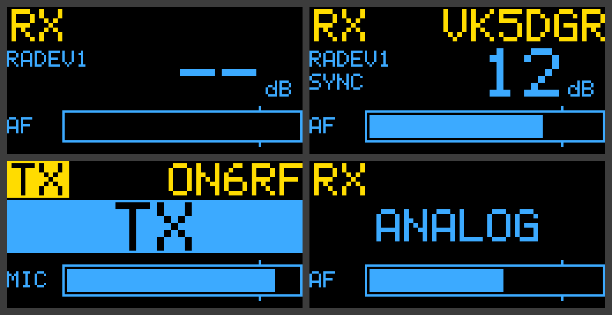

# freedv-embedded

A headless FreeDV modem for a Raspberry Pi. It sits between a radio and a
headset and adds RADE V1 to a radio that does not have it.

```
 headset mic ──> [sound card 2] ──> TX: RADE encode ──> [sound card 1] ──> radio audio in
 headphones  <── [sound card 2] <── RX: RADE decode <── [sound card 1] <── radio audio out

 PTT button ──> GPIO in ──> PTT state machine ──> PTT out (radio VOX, or GPIO)
 mode switch ─> GPIO in ──┘       │
                                  └──> display (SNR, AF level, modem state, callsign)
```

In analog mode the two RADE boxes are bypassed and audio passes straight
through.

Status: runs on a Raspberry Pi 4 with two USB sound cards. See "What is tested" below.

## Where the FreeDV code comes from

No FreeDV code is copied into this repository. Upstream is split like this
(checked in November 2026):

| Repository | Content | How it gets here |
|---|---|---|
| [freedv/freedv-backend](https://github.com/freedv/freedv-backend) | Audio pipeline, resampling, TX/RX threads, callsign text. Its README says it is meant to be used as a submodule. | git submodule at `external/freedv-backend` |
| [freedv/rade_c](https://github.com/freedv/rade_c) | RADE in C, no Python. V1 and V2 are both in it, selected by a flag in `rade_open()`. | fetched by freedv-backend at build time |
| Opus (FARGAN vocoder), RNNoise | | fetched by rade_c and freedv-backend at build time |

The same backend is used by the upstream headless programs in
[freedv/freedv-integrations](https://github.com/freedv/freedv-integrations)
(FlexRadio and KA9Q). `src/modem/Modem.cpp` follows what those do.

To move to a newer upstream:

```bash
git submodule update --remote external/freedv-backend
```

One thing to know: freedv-backend fetches rade_c from its `main` branch, not
from a pinned commit. A clean build therefore always gets the newest RADE, even
if the submodule commit did not change.

RADE V2: `rade_c` has it behind `RADE_MODE_V2`. The mode name is mapped to
flags in one function, `radeFlagsForMode()` in `src/modem/Modem.cpp`. V2 is
not enabled there yet because freedv-backend's pipeline is only used with V1
upstream today.

## Layout

```
CMakeLists.txt
external/freedv-backend/     submodule, never edited here
config/                      example configuration file
systemd/                     service unit
src/
  main.cpp                   argument parsing, signals
  app/Config.*               TOML file -> Config struct, with validation
  app/Controller.*           builds everything, runs the PTT state machine
  modem/Modem.*              the only code that includes upstream headers
  modem/ModemStatus.h        the snapshot a display receives
  audio/IAudioStream.h       one direction of one device, 16 bit mono
  audio/AlsaStream.*         ALSA backend
  audio/NullStream.*         silence, for running without hardware
  audio/AudioPump.*          one thread per stream, level meter, playback prebuffer
  audio/AnalogPath.*         analog mode: card to card, with resampling
  audio/AudioFactory.*       config -> stream
  ptt/IPtt.h                 IPttInput, IPttOutput, IModeSwitch
  ptt/GpioLine.*             GPIO through the kernel character device
  ptt/ConsoleKeys.*          keyboard for bench tests: space = PTT, a = analog
  ptt/PttFactory.*           config -> PTT input, PTT output, mode switch
  display/IDisplay.h         update(ModemStatus)
  display/ConsoleDisplay.*   status line on stderr
  display/Framebuffer.*      128x64 one bit canvas, text, rectangles
  display/Font5x7.h          font
  display/StatusScreen.*     ModemStatus -> Framebuffer, no hardware involved
  display/Ssd1306Display.*   sends the framebuffer to an SSD1306 over I2C
  display/DisplayFactory.cpp config -> display(s)
  util/Log.*                 log levels
tests/
```

Each of `audio`, `ptt` and `display` is an interface plus a factory that picks
an implementation from the `type` key in the config file. Adding hardware means
adding one class and one line in the factory:

| Planned | Where |
|---|---|
| PTT in from a CMX108 or similar | new `IPttInput` in `src/ptt`, new `type` in `PttFactory.cpp` and `Config.cpp` |
| PTT out through hamlib or rigctld | new `IPttOutput` in `src/ptt` |
| Other displays | new `IDisplay` in `src/display`; `StatusScreen` can be reused for any 128x64 panel |
| I2S codec, other audio paths | new `IAudioStream` in `src/audio`, or just a different ALSA device name |

Threads at run time: four audio pump threads (one per stream direction), the
backend's TX and RX threads, the display thread, and the control thread, which
polls PTT and the mode switch every 5 ms.

## Build on the Pi

Raspberry Pi OS 64 bit. The build needs network access (Opus, RNNoise and
rade_c are downloaded) and takes a while the first time.

```bash
sudo apt install build-essential cmake git autoconf automake libtool wget patch libasound2-dev libsamplerate0-dev libebur128-dev
```

```bash
git clone --recurse-submodules https://github.com/ManoDaSilva/freedv-embedded.git
```

```bash
cmake -S freedv-embedded -B freedv-embedded/build
```

```bash
cmake --build freedv-embedded/build -j4
```

Use the default Makefile generator. Ninja does not work, because the upstream
build files use `$(MAKE)`.

## Configure and run

Copy `config/freedv-embedded.example.toml` and edit it. Every key is described
there. Device names come from `aplay -L` and `arecord -L`, GPIO chips and lines
from `gpioinfo`.

```bash
./build/src/freedv-embedded -c my.toml --check-config
```

```bash
./build/src/freedv-embedded -c my.toml
```

With `type = "null"` for both sound cards and `type = "none"` for PTT input,
the program runs without any hardware (see `tests/null-audio.toml`).

`systemd/freedv-embedded.service` is a starting point for running it at boot.

## PTT sequence

```
Receive ── PTT pressed ──> Transmit ── PTT released ──> TransmitEnding ── drained ──> Receive
```

- PTT pressed: PTT out is asserted, then `tx_delay_ms` later the modem starts.
- PTT released: microphone audio stops. RADE then sends an end-of-over frame,
  which carries the callsign. The radio has to stay keyed for it.
- When that frame has been handed to the sound card, the program waits
  `tx_tail_ms` and releases PTT out.

For bench tests without a button, set `ptt.input.type = "console"`. The space
bar then toggles transmit: press once to start, once more to stop. It is a
toggle because a terminal does not report key releases. It needs a terminal, so
it does not work under systemd.

## Analog mode

`[mode_switch]` selects between digital and analog (transparent) mode. In
analog mode the modem is bypassed: microphone audio goes to the radio while PTT
is pressed, and radio audio goes to the headset otherwise. PTT out works the
same in both modes.

- `type = "gpio"` with `action = "toggle"`: a push button, each press changes the mode.
- `type = "gpio"` with `action = "level"`: a latching switch, active means analog.
- `type = "console"`: the `a` key changes the mode.
- `modem.start_mode` sets the mode after start-up.

The mode only changes while receiving. A change requested during an over takes
effect when the over ends. Analog audio is passed at unity gain; set levels
with `alsamixer`.

## Display

`display.type` takes one name or a list, for example
`type = ["ssd1306", "console"]`.

`ssd1306` drives a 128x64 SSD1306 OLED on I2C (the common 0.96 inch modules).

### Wiring

| Display pin | Pi header pin |
|---|---|
| VCC | pin 1 (3.3 V) |
| GND | pin 6 |
| SDA | pin 3 (GPIO 2) |
| SCL | pin 5 (GPIO 3) |

### Enable I2C on the Pi

I2C is off by default on Raspberry Pi OS. Enable it once:

```bash
sudo raspi-config nonint do_i2c 0
```

The same setting is in the menu of `sudo raspi-config` under "Interface
Options", "I2C". It adds `dtparam=i2c_arm=on` to `/boot/firmware/config.txt`
and makes `/dev/i2c-1` appear. No reboot is needed for this step.

Install the I2C tools and let your user access the bus:

```bash
sudo apt install i2c-tools
```

```bash
sudo usermod -aG i2c $USER
```

Log out and in again for the group change to apply. Then look for the display:

```bash
i2cdetect -y 1
```

The table should show `3c` (some modules use `3d`). If the table is empty,
check the wiring. Put the address in the config file:

```toml
[display]
type = ["ssd1306", "console"]
i2c_device = "/dev/i2c-1"
i2c_address = 0x3C
```

If the program stops at start-up with "ssd1306: cannot open /dev/i2c-1", I2C
is not enabled or the user is not in the `i2c` group. If it reports "I2C write
failed", the address or the wiring is wrong.

### Refresh rate

`display.refresh_ms` sets how often the screen is redrawn. The default is 250,
which is four times per second. The allowed range is 50 to 10000.

The I2C bus is the practical limit. Only the parts of the screen that changed
are sent, in strips of 8 pixel rows. Calculated transfer times, not measured:

| | 100 kHz bus (Pi default) | 400 kHz bus |
|---|---|---|
| One strip | about 13 ms | about 3 ms |
| AF bar changed (2 strips) | about 25 ms | about 6 ms |
| Whole screen changed (8 strips) | about 100 ms | about 25 ms |

The display thread draws and then sleeps `refresh_ms`, so the real period is
`refresh_ms` plus the transfer time. The level meter is a peak meter that falls
25 dB per second, so short peaks stay visible between updates.

For a livelier bar, raise the bus speed and lower `refresh_ms` to about 100.
Add this line to `/boot/firmware/config.txt` and reboot:

```
dtparam=i2c_arm_baudrate=400000
```

At 100 kHz, values below about 100 are not useful, because a full screen
change already takes that long. The display has its own thread, so a slow
display does not delay PTT or audio.

### What it shows

The top 16 rows are a header: RX or TX on the left, a callsign on the right
(the last one heard while receiving, your own while transmitting). Below it,
the SNR is the largest element, with the mode and sync next to it, and the AF
level bar from the radio at the bottom (-60 to 0 dBFS, with a mark at -10).
While transmitting, the SNR is replaced by an inverted TX band and the bar
shows the microphone level.

Two-colour modules (16 rows yellow, 48 rows blue) are supported by the layout:
the header fits the yellow strip exactly and the row at the colour change is
left empty, so nothing is cut in two. On a single colour display the same
layout reads as a header and a body.

Single colour:


Two-colour:



The picture is generated by the layout code itself, without a display:

```bash
mkdir -p /tmp/screens && ./build/tests/DisplayTest /tmp/screens
```

This writes one PBM image per situation. The layout is in
`src/display/StatusScreen.cpp`.

## Logging

`log.level` is `debug`, `info`, `warn` or `error`. It applies to this program
and to the FreeDV backend's logger. The two `rade_open` lines at start-up are
printed by RADE itself and do not follow it. The console status line is a
display, not a log message; turn it off with `display.type`.

With `ptt.output.type = "none"` the radio keys itself from the audio (sound
card VOX), and the sequence only controls the modem.

## What is tested

Run the tests with:

```bash
ctest --test-dir build --output-on-failure
```

| Test | Checks | State |
|---|---|---|
| `config` | Example file parses, defaults, typos and bad values are rejected | passes |
| `audio_pump` | Capture pacing, playback prebuffer and drain, on null devices | passes |
| `analog_path` | Pass-through, resampling 48 kHz to 44.1 kHz, overflow, clear | passes |
| `display` | Status screen layout: level bars, TX box, SNR, callsign | passes |
| `modem_loopback` | Speech in, modem signal out, back into the receiver, sync and callsign decode | passes on a Pi 4 |
| `daemon_null_audio` | Whole program on null devices for 3 seconds | passes on a Pi 4 |

Tried on a Pi 4 with two USB sound cards: receive, transmit, console PTT.

Not tested yet: GPIO lines, the mode switch and analog mode with real audio,
the SSD1306 on real hardware (only the rendering is tested), and CPU load.

## Next steps

1. Try analog mode and the SSD1306 on the Pi.
2. GPIO PTT and mode switch.
3. Measure CPU load in RX and TX on the Pi.
4. PTT out through hamlib or rigctld.
