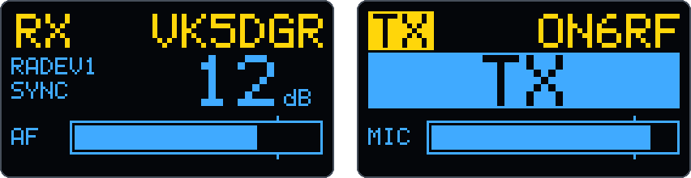
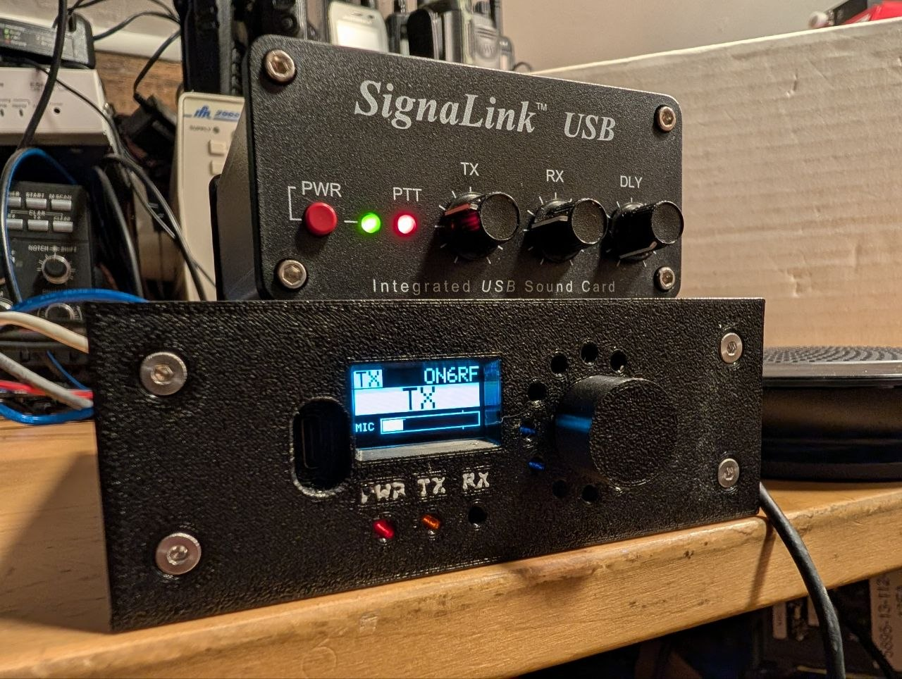
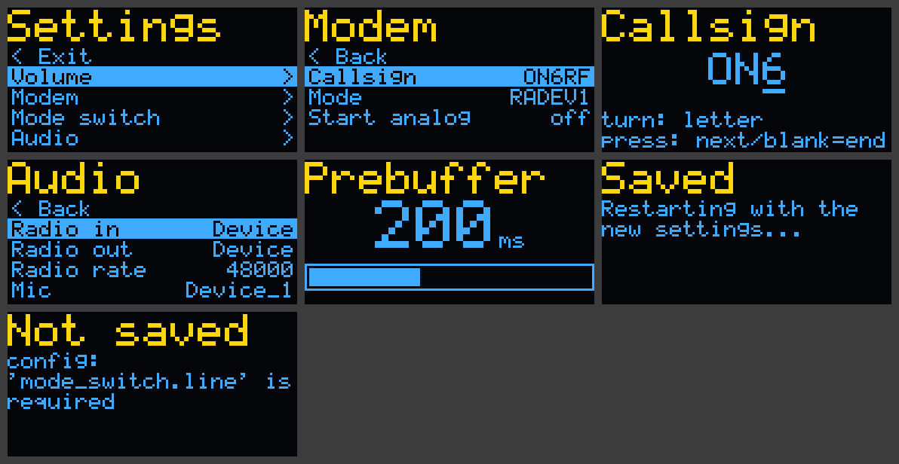

# freedv-embedded

A headless FreeDV modem for a Raspberry Pi. It sits between a radio and a
headset and adds RADE V1 to a radio that does not have it.

<p align="center">
  
</p>

<p align="center">
  The status screen on a two-colour SSD1306, receiving (left) and transmitting (right).
</p>

<p align="center">
  
</p>

<p align="center">
  Implementation in a 3D-printed case, with a <a href="https://github.com/Jankyneering/rack-ui">RackUI module.</a>
</p>

## Contents

- [What it does](#what-it-does)
- [How it works](#how-it-works)
- [Getting started](#getting-started)
  - [What you need](#what-you-need)
  - [1. Prepare the Pi](#1-prepare-the-pi)
  - [2. Install](#2-install)
  - [3. Check the build](#3-check-the-build)
  - [4. Find the sound cards](#4-find-the-sound-cards)
  - [5. Write your config](#5-write-your-config)
  - [6. First run](#6-first-run)
  - [7. First transmit](#7-first-transmit)
  - [8. What next](#8-what-next)
  - [If something goes wrong](#if-something-goes-wrong)
  - [Words used here](#words-used-here)
- [Hardware](#hardware)
- [Build](#build)
- [Configure and run](#configure-and-run)
- [PTT](#ptt)
- [Radio control (CAT)](#radio-control-cat)
- [FreeDV Reporter](#freedv-reporter)
- [Analog mode](#analog-mode)
- [Display](#display)
  - [Wiring](#wiring)
  - [Enable I2C on the Pi](#enable-i2c-on-the-pi)
  - [What it shows](#what-it-shows)
  - [Refresh rate](#refresh-rate)
- [Settings menu](#settings-menu)
  - [Controls](#controls)
  - [What is in the menu](#what-is-in-the-menu)
  - [Saving](#saving)
  - [System and shut down](#system-and-shut-down)
  - [Volume](#volume)
- [Start at boot](#start-at-boot)
- [Logging](#logging)
- [Project layout](#project-layout)
- [Where the FreeDV code comes from](#where-the-freedv-code-comes-from)
- [Tests](#tests)
- [Status and next steps](#status-and-next-steps)
- [Acknowledgements](#acknowledgements)
- [Use of AI tools](#use-of-ai-tools)
- [License](#license)

## What it does

- Encodes and decodes RADE V1 with the upstream FreeDV code, pulled in as a
  git submodule.
- Uses two sound cards: one for the radio, one for the headset.
- PTT from a GPIO line or from the keyboard. PTT out through the radio's VOX
  or a GPIO line.
- Analog mode: a switch bypasses the modem and passes audio straight through.
- Status on an SSD1306 OLED and on the console: SNR, AF level, sync, mode,
  callsign.
- A settings menu on the display, operated with a rotary encoder: callsign,
  audio devices, volume and the other settings, saved back to the config file.
- Spotting on FreeDV Reporter, and optionally PSK Reporter.
- One TOML config file. Unknown keys and bad values are reported as errors.

## How it works

```
 headset mic ──> [sound card 2] ──> TX: RADE encode ──> [sound card 1] ──> radio audio in
 headphones  <── [sound card 2] <── RX: RADE decode <── [sound card 1] <── radio audio out

 PTT button ──> GPIO in ──> PTT state machine ──> PTT out (radio VOX, or GPIO)
 mode switch ─> GPIO in ──┘       │
                                  └──> display (SNR, AF level, modem state, callsign)
```

In analog mode the two RADE boxes are bypassed.

Threads at run time: four audio threads (one per stream direction), the
backend's TX and RX threads, the user interface thread (knob, menu, displays),
and the control thread, which polls PTT and the mode switch every 5 ms.

## Getting started

This section goes from an empty SD card to a first received signal, one step
at a time. If you already run Linux on a Pi, the reference sections further
down are shorter: [build](#build), [configure and run](#configure-and-run).

### What you need

| Item | Notes |
|---|---|
| Raspberry Pi 4 | With a power supply and a microSD card of 8 GB or more |
| A computer | To prepare the SD card and to type commands on the Pi over the network |
| Network | Wi-Fi or a cable. The Pi downloads about 250 MB during the install. |
| Radio with a USB socket for audio | For example an Icom IC-705: one USB cable carries the audio and the radio control. A radio without USB audio needs a USB sound card and an audio lead instead. |
| USB headset, or a USB sound card with a headset | For your own microphone and headphones |

A display and a knob are optional and come later.

### 1. Prepare the Pi

1. Install [Raspberry Pi Imager](https://www.raspberrypi.com/software/) on
   your computer and put the SD card in.
2. In the Imager choose your Pi model, then "Raspberry Pi OS (other)", then
   "Raspberry Pi OS Lite (64-bit)". "Lite" has no desktop, which is all this
   needs.
3. When the Imager offers to customise the settings, do so:
   - a host name, for example `freedv`
   - a user name and a password
   - your Wi-Fi name and password, unless you use a cable
   - under "Services", enable SSH
4. Write the card, put it in the Pi and power it on. Wait two minutes.
5. On your computer, open a terminal (on Windows: PowerShell) and connect.
   Replace `pi` with the user name and `freedv` with the host name you chose:

```bash
ssh pi@freedv.local
```

Answer "yes" to the question about the fingerprint and type your password.
You now have a command line on the Pi. Everything below is typed there.

### 2. Install

Install the programs and libraries the build needs:

```bash
sudo apt update
```

```bash
sudo apt install -y build-essential cmake git autoconf automake libtool wget patch libasound2-dev libsamplerate0-dev libebur128-dev libhamlib-dev libhamlib-utils libssl-dev i2c-tools
```

Download this project. `--recurse-submodules` matters: it also fetches the
FreeDV code this project builds on.

```bash
git clone --recurse-submodules https://github.com/ManoDaSilva/freedv-embedded.git
```

Build it. This downloads more code and data, and takes about five minutes on
a Pi 4.

```bash
cmake -S freedv-embedded -B freedv-embedded/build
```

```bash
cmake --build freedv-embedded/build -j4
```

The last lines should read `[100%] Built target freedv-embedded`.

### 3. Check the build

```bash
ctest --test-dir freedv-embedded/build --output-on-failure
```

You should see `100% tests passed`. The `modem_loopback` test runs speech
through the whole modem, so a pass means the build is sound.

### 4. Find the sound cards

Plug in the radio's USB cable and the headset. List the sound cards:

```bash
arecord -L | grep plughw
```

The output has one line per card, like this:

```
plughw:CARD=CODEC,DEV=0
plughw:CARD=Headset,DEV=0
```

`CODEC` is the name Icom radios (and many others) use for their built-in sound
card. Your headset will have a different name. If you cannot tell which is
which, unplug one and run the command again: the line that disappears belongs
to it. Write both lines down.

### 5. Write your config

Copy the example config to your home directory:

```bash
cp freedv-embedded/config/freedv-embedded.example.toml ~/modem.toml
```

Open it in the editor:

```bash
nano ~/modem.toml
```

Change these things, and leave the rest:

| Where | Change |
|---|---|
| `[modem]`, `callsign` | Your callsign, between the quotes |
| `[audio.radio]`, `capture_device` and `playback_device` | The radio's line from step 4, in both |
| `[audio.headset]`, `capture_device` and `playback_device` | The headset's line from step 4, in both |
| `[ptt.input]`, `type` | `"console"`, so the space bar is your PTT for now |

Save with Ctrl+O and Enter, leave with Ctrl+X. Then let the program check the
file:

```bash
freedv-embedded/build/src/freedv-embedded -c ~/modem.toml --check-config
```

It prints `OK`, or the key that is wrong.

### 6. First run

```bash
freedv-embedded/build/src/freedv-embedded -c ~/modem.toml
```

A status line appears and updates when something changes:

```
RX     RADEV1 sync=no  snr=  -- dB  af= -32 dBFS  mic= -45 dBFS  call=-
```

| Field | Meaning |
|---|---|
| `RX` or `TX` | Receiving or transmitting |
| `sync` | `yes` when a RADE signal is being decoded |
| `snr` | Signal quality, shown with sync |
| `af` | Level of the audio coming from the radio. -99 means nothing arrives. |
| `mic` | Level of your microphone |
| `call` | The last callsign received |

Tune the radio to a frequency where FreeDV RADE is in use, in USB (LSB below
10 MHz), with the radio's filter at its widest. With a RADE signal present,
`sync` turns to `yes` and you hear speech in the headset.

If `af` stays very low with band noise present, raise the level: run
`alsamixer`, press F6 to pick the radio's card, F4 for the capture controls.
On an Icom, the radio's own USB audio output level setting matters as well.

Stop the program with Ctrl+C.

### 7. First transmit

Connect a dummy load, or reduce the power and pick a clear frequency.

Start the program, press the space bar once, speak, press space again. The
status line shows `TX` in between, and `mic` shows your voice level.

How the radio gets keyed depends on `[ptt.output]`:

- With `type = "none"`, the setting in the example, this program does not key
  the radio. The radio must do it from the audio (VOX).
- With `type = "rig"`, the program keys the radio over its USB control
  connection. See [radio control](#radio-control-cat). For an IC-705 the
  Hamlib model number is 3085.

Have someone listen, or use a second receiver with FreeDV, to confirm your
signal decodes.

### 8. What next

| To | See |
|---|---|
| Key the radio and read its frequency over USB | [Radio control (CAT)](#radio-control-cat) |
| Use a real PTT button | [PTT](#ptt) |
| Add a display | [Display](#display) |
| Add a knob and change settings without a keyboard | [Settings menu](#settings-menu) |
| Switch to analog (normal SSB) and back | [Analog mode](#analog-mode) |
| Have it start when the Pi is powered on | [Start at boot](#start-at-boot) |

### If something goes wrong

| You see | Cause and fix |
|---|---|
| `external/freedv-backend is empty` during `cmake` | The clone was made without `--recurse-submodules`. Run `git -C freedv-embedded submodule update --init`, then `cmake` again. |
| The build stops while downloading | The network dropped. Run the `cmake --build` command again. |
| `cannot open ALSA device` | The device name in the config does not match a card. Run the command from step 4 again and compare, letter for letter. |
| `af= -99` and it never moves | No audio from the radio. Check the cable, the radio's USB audio output setting, and the capture level in `alsamixer`. |
| `sync=no` on a signal you know is RADE | The radio is not in USB (or LSB), is off frequency, or the audio level is far too low or too high. |
| `Permission denied` for `/dev/gpiochip0`, `/dev/i2c-1` or a serial port | Your user is missing a group. Run `sudo usermod -aG gpio,i2c,dialout,audio $USER`, then log out and in again. |
| `config: unknown key ...` | A typing mistake in the config. The message names the key. |

### Words used here

| Word | Meaning |
|---|---|
| RADE | Radio Autoencoder, the FreeDV digital voice mode this program speaks |
| PTT | Push to talk: the signal that switches the radio to transmit |
| VOX | The radio keys itself when it hears audio |
| CAT | Controlling the radio from a computer, here over USB |
| SNR | Signal to noise ratio, in dB. Higher is better. |
| ALSA | The sound system of Linux. `alsamixer` and `arecord` belong to it. |
| GPIO | The Pi's pins for switches and lamps |
| I2C | The two-wire bus the display and the knob module use |

## Hardware

| Part | Notes |
|---|---|
| Raspberry Pi | Tried on a Pi 4 with the 64 bit Raspberry Pi OS |
| Sound card for the radio | Any ALSA device. USB cards work. |
| Sound card for the headset | Same |
| PTT button | Optional. A GPIO line, or the space bar for bench tests. |
| Mode switch | Optional. A push button or a latching switch on a GPIO line. |
| Display | Optional. 128x64 SSD1306 OLED on I2C, single or two-colour. |
| Menu knob | Optional. A rotary encoder with push button on three GPIO lines, or a [Rack UI](https://github.com/Jankyneering/rack-ui) module on the I2C bus. |

## Build

The build needs network access. Opus, RNNoise and rade_c are downloaded the
first time, which takes a while.

```bash
sudo apt install build-essential cmake git autoconf automake libtool wget patch libasound2-dev libsamplerate0-dev libebur128-dev libhamlib-dev libhamlib-utils libssl-dev
```

```bash
git clone --recurse-submodules https://github.com/ManoDaSilva/freedv-embedded.git
```

```bash
cmake -S freedv-embedded -B freedv-embedded/build
```

```bash
cmake --build freedv-embedded/build -j4
```

Use the default Makefile generator. Ninja does not work, because the upstream
build files use `$(MAKE)`.

## Configure and run

Copy `config/freedv-embedded.example.toml` and edit it. Every key is described
in that file.

| Section | Sets |
|---|---|
| `[log]` | Log level |
| `[modem]` | Mode, callsign, mode at start-up |
| `[mode_switch]` | The digital/analog switch |
| `[audio]`, `[audio.radio]`, `[audio.headset]` | Sound devices, sample rates, buffering |
| `[rig]` | The radio's control connection (CAT) |
| `[reporting]` | FreeDV Reporter and PSK Reporter |
| `[ptt.input]`, `[ptt.output]` | PTT button, radio keying, TX timing |
| `[display]` | Console status line, SSD1306 |
| `[menu]` | The knob that operates the settings menu |

Device names come from `aplay -L` and `arecord -L`. Use the `plughw:` names.
GPIO chips and lines come from `gpioinfo`.

Check the file, then run:

```bash
./build/src/freedv-embedded -c my.toml --check-config
```

```bash
./build/src/freedv-embedded -c my.toml
```

With `type = "null"` for both sound cards and `type = "none"` for PTT input,
the program runs without any hardware. See `tests/null-audio.toml`.

To run it at every power-on, see [start at boot](#start-at-boot).

## PTT

```
Receive ── PTT pressed ──> Transmit ── PTT released ──> TransmitEnding ── drained ──> Receive
```

- PTT pressed: PTT out is asserted, then the modem starts `tx_delay_ms` later.
- PTT released: microphone audio stops. RADE then sends an end-of-over frame,
  which carries the callsign. The radio has to stay keyed for it.
- When that frame has been handed to the sound card, the program waits
  `tx_tail_ms` and releases PTT out.

PTT input (`ptt.input.type`):

| Type | Behaviour |
|---|---|
| `gpio` | A button on a GPIO line. Transmits while pressed. |
| `console` | The space bar toggles transmit: once to start, once more to stop. |
| `none` | Receive only |

The keyboard is a toggle because a terminal does not report key releases. It
needs a terminal, so it does not work under systemd.

PTT output (`ptt.output.type`):

| Type | Behaviour |
|---|---|
| `none` | The radio keys itself from the audio (sound card VOX) |
| `gpio` | A GPIO line keys the radio |
| `reporter_link` | The network part of reporting links the way the program links it. Builds only, does not connect. |
| `reporting` | What is reported and when: start, frequency changes and their rate, transmit, sync, decoded callsigns, radio offline, analog mode |
| `rig` | The radio is keyed over its control connection, see [radio control](#radio-control-cat) |

## Radio control (CAT)

`[rig]` describes the radio's control connection. It goes through
[Hamlib](https://hamlib.github.io/), so it works with the radios Hamlib
supports. One connection serves several uses: keying the transmitter, and
reading the radio's frequency, which [FreeDV Reporter](#freedv-reporter) uses.

Hamlib is an optional build dependency. Install it before running CMake:

```bash
sudo apt install libhamlib-dev libhamlib-utils
```

CMake then prints "Hamlib found: CAT control enabled". Without it the program
still builds, and refuses `type = "hamlib"` with an explanation.

If you install Hamlib after the first build, run the `cmake -S ... -B ...`
command again before building. `cmake --build` alone does not look for newly
installed libraries. Nothing has to be deleted.

Example for an Icom IC-7300 on its USB socket, keyed over CAT:

```toml
[rig]
type = "hamlib"
model = 3073
device = "/dev/ttyUSB0"
baud = 19200

[ptt.output]
type = "rig"
tx_delay_ms = 50
```

| Key | Meaning |
|---|---|
| `model` | Hamlib model number. `rigctl -l` lists them. |
| `device` | Serial port. The names under `/dev/serial/by-id/` stay the same whichever USB socket is used. For a network connection, `host:port`. |
| `baud` | Must match the radio's setting. Leave out for the model's default. |
| `ptt` | How the radio is keyed. `cat`: a CAT command. `rts` or `dtr`: that hardware line of the serial port. |
| `civ_address` | Icom only. Leave out for the model's default. |
| `poll_ms` | How often the frequency is read. 0 turns it off. |

On the IC-7300, the baud rate is in the radio's menu under "CI-V USB Baud
Rate". The built-in USB sound card is the same cable, so audio and CAT need
only one USB lead. For `ptt = "rts"` or `"dtr"`, set "USB SEND" in the radio's
menu to the same line.

To check the connection before using it here:

```bash
rigctl -m 3073 -r /dev/ttyUSB0 -s 19200 f
```

It prints the frequency when the radio answers. The user needs access to the
serial port, which on Raspberry Pi OS means being in the `dialout` group.

How it behaves:

- The radio is talked to on its own thread. A slow or disconnected radio does
  not delay audio or the PTT sequence.
- The program starts even when the radio is off. It tries to connect every
  three seconds and logs when the connection comes and goes.
- Keying waits up to 500 ms for the radio to accept the command, then carries
  on and logs a warning. The request stays in force.
- After connecting, and when the program stops, the radio is unkeyed.
- The frequency is shown on the console status line. It is not read while
  transmitting, so PTT commands never wait behind a poll.

To share the radio with other programs, such as a logger, run Hamlib's
`rigctld` and connect to it with `model = 2` and `device = "localhost:4532"`.

`[rig]` is also in the settings menu: type, model number, serial port (from a
list of the ports present), baud rate and PTT method. The System menu has a
"Rig" row with the radio's frequency, or "offline" while it does not answer.

Keying with a hardware line of the serial port (RTS or DTR) is done here too:
set `ptt = "rts"` or `ptt = "dtr"` in `[rig]`, together with
`ptt.output.type = "rig"`. In the menu it is "PTT via" under "Rig".

## FreeDV Reporter

[FreeDV Reporter](https://qso.freedv.org) is a live map and list of FreeDV
stations. With reporting on, this station appears there with its callsign,
locator, frequency and software version, shows when it transmits, and lists
the callsigns it receives with their SNR.

```toml
[modem]
callsign = "ON6RF"

[reporting]
enabled = true
grid_square = "JO20eu"
message = "Pi 4 and IC-705"
frequency = "rig"
psk_reporter = false
```

| Key | Meaning |
|---|---|
| `enabled` | Reporting on or off. Off by default. |
| `grid_square` | Your Maidenhead locator, 4 or 6 characters. Required when enabled. |
| `message` | Free text shown next to your entry, up to 80 characters |
| `frequency` | `"rig"`: the frequency read over CAT, see [radio control](#radio-control-cat). Or a fixed frequency in Hz, such as `14236000`, for a radio without CAT. |
| `psk_reporter` | Also send received callsigns to [PSK Reporter](https://pskreporter.info) |

The callsign is `modem.callsign`, the one the modem sends at the end of each
over. Reporting needs a callsign and a locator; the config check refuses
`enabled = true` without them.

What is reported, and when:

| Event | Report |
|---|---|
| Start | The station: callsign, locator, software name and version, receive only or not |
| Frequency change | The new frequency, at most once a second |
| Radio offline, with `frequency = "rig"` | No frequency, until the radio answers again |
| PTT pressed and released | Transmitting, with the mode (`RADEV1`) |
| Receiving a signal with sync | A receive report with the SNR, once a second |
| Callsign decoded at the end of an over | That callsign and the SNR. With `psk_reporter = true` also to PSK Reporter, when the frequency is known. |
| Analog mode | The station is hidden from the list while in analog mode |

The software is advertised as the name and version printed at start-up, for
example `freedv-embedded 0.1.0`. A station without a PTT input
(`ptt.input.type = "none"`) is reported as receive only.

The connection runs in the background over TLS, and reconnects by itself
after a network outage. A slow or absent network does not affect audio or
PTT. PSK Reporter receives the collected callsigns every five minutes.

"Reporting" in the settings menu has the same settings, except the message,
which is free text and set in the file. The System menu has a "Reporter" row:
connecting, connected or offline.

Building with reporting needs OpenSSL's development files (`libssl-dev`),
which are in the install line under [build](#build). Without them the build
downloads and builds LibreSSL instead, which takes longer.

## Analog mode

In analog mode the modem is bypassed. Microphone audio goes to the radio while
PTT is pressed, and radio audio goes to the headset otherwise. PTT out works
the same in both modes.

`[mode_switch]` selects the mode:

| Setting | Behaviour |
|---|---|
| `type = "gpio"`, `action = "toggle"` | A push button. Each press changes the mode. |
| `type = "gpio"`, `action = "level"` | A latching switch. Active means analog. |
| `type = "console"` | The `a` key changes the mode |
| `type = "none"` | The mode stays at `modem.start_mode` |

A short press on the menu knob also switches the mode, with any of these
types except the latching switch. See [controls](#controls).

The mode only changes while receiving. A change requested during an over takes
effect when the over ends. Analog audio is passed at unity gain. Set levels
with `alsamixer`.

## Display

`display.type` takes one name or a list, for example
`type = ["ssd1306", "console"]`.

| Type | Output |
|---|---|
| `console` | One status line on stderr, printed when something changes |
| `ssd1306` | A 128x64 SSD1306 OLED on I2C (the common 0.96 inch modules) |
| `none` | Nothing |

### Wiring

| Display pin | Pi header pin |
|---|---|
| VCC | pin 1 (3.3 V) |
| GND | pin 6 |
| SDA | pin 3 (GPIO 2) |
| SCL | pin 5 (GPIO 3) |

### Enable I2C on the Pi

I2C is off by default on Raspberry Pi OS. Enable it once:

```bash
sudo raspi-config nonint do_i2c 0
```

The same setting is in the menu of `sudo raspi-config` under "Interface
Options", "I2C". It adds `dtparam=i2c_arm=on` to `/boot/firmware/config.txt`
and makes `/dev/i2c-1` appear.

Install the I2C tools and let your user access the bus:

```bash
sudo apt install i2c-tools
```

```bash
sudo usermod -aG i2c $USER
```

Log out and in again for the group change to apply. Then look for the display:

```bash
i2cdetect -y 1
```

The table should show `3c`. Some modules use `3d`. If the table is empty,
check the wiring. Put the address in the config file:

```toml
[display]
type = ["ssd1306", "console"]
i2c_device = "/dev/i2c-1"
i2c_address = 0x3C
```

Start-up errors and their causes:

| Message | Cause |
|---|---|
| `ssd1306: cannot open /dev/i2c-1` | I2C is not enabled, or the user is not in the `i2c` group |
| `ssd1306: I2C write failed` | Wrong address or wiring |

### What it shows

| Area | Receiving | Transmitting |
|---|---|---|
| Header, left | `RX` | `TX`, inverted |
| Header, right | Last callsign heard | Your own callsign |
| Body, top | SNR in large digits, with the mode and `SYNC` | Inverted `TX` band |
| Body, bottom | AF level from the radio | Microphone level |

The level bar covers -60 to 0 dBFS and has a mark at -10.

The header is exactly 16 rows high and the row below it is left empty. Two-colour
modules have 16 rows in one colour above 48 in another, so nothing is cut by
the colour change. On a single colour display the same layout reads as a header
and a body.

Two-colour display, in four situations (idle, receiving, transmitting, analog):


Single colour display:


These pictures are generated by the layout code itself, without a display:

```bash
mkdir -p /tmp/screens && ./build/tests/DisplayTest /tmp/screens
```

This writes one PBM image per situation. The layout is in
`src/display/StatusScreen.cpp`.

### Refresh rate

`display.refresh_ms` sets how often the screen is redrawn. The default is 250,
which is four times per second. The allowed range is 50 to 10000.

The I2C bus is the practical limit. It runs at 100 kHz, and only the parts of
the screen that changed are sent, in strips of 8 pixel rows. Calculated
transfer times, not measured:

| Change | Time |
|---|---|
| One strip | about 13 ms |
| AF bar changed (2 strips) | about 25 ms |
| Whole screen changed (8 strips) | about 100 ms |

The display thread draws and then sleeps `refresh_ms`, so the real period is
`refresh_ms` plus the transfer time. The level meter is a peak meter that falls
25 dB per second, so short peaks stay visible between updates.

Values below about 100 are not useful, because a full screen change already
takes that long. The display has its own thread, so a slow display does not
delay PTT or audio.

## Settings menu

With a knob connected, the display also offers a menu that changes the
settings in the config file.



### Controls

| Where | Action | Effect |
|---|---|---|
| Status screen | Long press | Opens the menu |
| Status screen | Short press | Switches between digital and analog |
| Status screen | Turn | Changes the headphone volume |
| Menu | Turn | Moves the highlight, or changes the value being edited |
| Menu | Press | Enters a submenu, starts editing, confirms |
| Menu | Long press | Goes back, or cancels the edit. At the top level it closes the menu. |

Turning the knob on the status screen changes the headphone volume in steps of
2 %. The display shows the level for a moment, and the Rack UI LEDs show it as
a bar. The level is written to the config file three seconds after the last
turn, so it is kept across restarts. It is the same control as "Headphones" in
the volume menu.

The short press changes the mode the same way the mode switch does: only while
receiving, and a press during an over takes effect when the over ends. With a
latching mode switch (`action = "level"`) the switch position is the mode, and
the knob press is ignored.

Every menu also starts with a back entry. The menu closes after `timeout_s`
without input. PTT keeps working while the menu is open.

The knob is set in `[menu]`:

| `type` | Hardware |
|---|---|
| `gpio` | A rotary encoder on three GPIO lines: `line_a`, `line_b`, `line_button`. Contacts to ground, internal pull-ups. |
| `rackui` | A [Rack UI](https://github.com/Jankyneering/rack-ui) module on the same I2C bus as the display, at address 0x36 |
| `console` | The keyboard, for bench tests: arrow keys turn, Enter is a short press, `b` a long press |
| `none` | No menu |

For a GPIO encoder, wire the common pin to ground and the two phases and the
switch to three free GPIO lines. If one click of the knob moves two entries or
needs two clicks, change `steps_per_detent`. If it turns the wrong way, set
`reverse = true`.

The Rack UI module needs no settings beyond `type = "rackui"`. Its encoder
count and push count registers are read as they are, free-running, and the
differences are taken on the Pi.

The LEDs around the module's knob are set with `leds` in `[menu]`:

| `leds` | Status screen | Menu open |
|---|---|---|
| `level` (default) | A bar showing the AF level, or the microphone level while transmitting. It is the same value as the bar on the display. | Follow the knob |
| `follow` | Follow the knob | Follow the knob |
| `off` | Off | Off |

The bar uses nine of the twelve LEDs, the same arc as the module's own gauge
animation. `led_brightness` (1 to 64) sets how bright it is. Both settings are
also in the menu under "Controls".

For the bar, the program switches the module to manual LED control and writes
only the brightness registers that changed, at most 10 times per second. For
"follow" it selects the module's own following animation.

Once a second the program checks that the module still has the expected
animation and an untouched config register, and corrects them if not. If the
module drops out of LED level mode three times within a minute, the program
stops writing LED levels until its next start and lets the LEDs follow the
knob.

The module also has two separate lamps, TX_EN and RX_EN, wired to GPIO lines
instead of I2C:

| Lamp | Lit | Default line | Header pin |
|---|---|---|---|
| TX_EN | while transmitting | GPIO 22 (`tx_led_line`) | 15 |
| RX_EN | while the receiver has sync | GPIO 23 (`rx_led_line`) | 16 |

They are only driven with `type = "rackui"`. Set a line to -1 to leave that
lamp alone. Do not use these two lines for PTT or the mode switch.

At start-up the program waits up to 3 seconds for the module to answer, and
logs its firmware version.

The module reads are checked before they count. The module stretches the I2C
clock, which the Raspberry Pi's I2C controller does not always handle, so a
read can occasionally return wrong bytes without an error. A changed reading is
therefore only accepted when a second read returns the same values. Discarded
readings are counted in the log (`rackui: N unconfirmed reading(s) discarded`).

If the menu moves by itself, set `log.level = "debug"`. Every knob event is
then logged with what it did, and for the Rack UI every discarded reading.

Editing text (the callsign): turn to pick a letter, press to move to the next
position, press on a blank to finish.

### What is in the menu

| Menu | Config section | Settings |
|---|---|---|
| Volume | `[audio.radio]`, `[audio.headset]` | Radio in and out, microphone, headphones |
| Modem | `[modem]` | Callsign, mode, start in analog |
| Mode switch | `[mode_switch]` | Type, GPIO line, polarity, bias, action, debounce |
| Audio | `[audio]`, `[audio.radio]`, `[audio.headset]` | Sound device for each of the four directions, sample rates, period, prebuffer |
| Rig | `[rig]` | Type, Hamlib model number, serial port, baud rate, PTT method |
| Reporting | `[reporting]` | On or off, locator, frequency from the rig or fixed (in kHz), PSK Reporter |
| PTT | `[ptt.input]`, `[ptt.output]` | Types, GPIO lines, polarity, bias, debounce, TX delay and tail |
| Display | `[display]` | Refresh, contrast, rotation, console status line |
| Controls | `[menu]` | Knob direction, LED mode and brightness, long press time, menu timeout |
| Log | `[log]` | Level |
| System | | Read-only: IP address of each connected network interface, the radio's frequency, CPU load, memory in use, CPU temperature |
| Shut down | | Powers the Pi off cleanly, after a confirmation |

The audio device lists show the sound devices present at that moment, and only
those that work in that direction. A card that can only play is not offered as
a microphone or radio input.

Three settings are not in the menu on purpose: the display type, the display's
I2C address, and the knob's type and wiring. A wrong value there would switch
off the menu itself, with no way back except editing the file.

### Saving

Changes are collected and written when you choose "Save & restart". The
program then restarts itself with the new file. This takes a second or two and
only happens while receiving.

- Only the changed values are rewritten. Comments, blank lines and the order of
  the file stay as they are.
- Before the file is replaced, the new text is checked the same way as at
  start-up. A combination the program would refuse, such as a GPIO type
  without a line number, is not saved, and the screen shows the reason.
- A sound device that was changed must open before the change is saved. If it
  does not, the screen shows the reason and nothing is written.
- Radio control must be usable: Hamlib built in, and a model number it knows.
  Otherwise the screen shows the reason and nothing is written.
- The file is replaced in one step, so a power cut cannot leave half a file.
- "Discard changes" drops everything that is not saved yet.

The user running the program needs write access to the config file.

The same goes for radio control that cannot be set up at start-up: with a menu
configured, the program runs without it and the display shows the reason.

If a sound device cannot be opened at start-up, for example because it was
unplugged, the program keeps running when a menu is configured. That direction
runs on silence, the display shows which device failed, and another one can be
chosen under "Audio". Without a menu (`menu.type = "none"`) the program stops
with the error.

A sound device that disappears while the program runs never stops it. This
happens when the radio's USB cable is unplugged, which takes its sound card
and its control connection along. The program carries on with silence in that
direction, shows "Audio error" on the display, and tries the device again
every 2 seconds. When the cable is back, audio and radio control resume by
themselves and the message goes away.

### System and shut down

"System" shows readings about the Pi. The values update while the menu is
open. Which network rows exist is decided when the menu is entered, so after
plugging in a cable, leave "System" and enter it again.

| Row | Shows |
|---|---|
| `eth0`, `wlan0`, ... | The IPv4 address of that network interface. There is one row per interface that is up and has an address, so wired and Wi-Fi both show when both are connected. With none connected, a single "Network: none" row. |
| Rig | The radio's frequency, "connected" before the first reading, or "offline". Only with a `[rig]` set up. |
| Reporter | The FreeDV Reporter connection: connecting, connected or offline. Only with reporting on. |
| CPU | Load across all cores over the last second or so |
| RAM | Memory in use and total, in MB |
| Temp | CPU temperature |

"Shut down" powers the Pi off. It opens a confirmation with "back"
highlighted, so it takes a turn and a second press. The program then finishes
the current over if there is one, releases PTT, closes the sound devices, and
runs the shutdown command. Wait until the Pi's green light stops blinking
before removing power.

The default command is `systemctl poweroff`, then `sudo -n systemctl poweroff`
if that is refused. Unless the program runs as root, both need a permission
that a normal user does not have, even on Raspberry Pi OS. Without it the log
shows "Interactive authentication required" and "a password is required".

Give the user that runs the program the right to this one command. Create the
rule with `visudo`, which checks it before saving:

```bash
sudo visudo -f /etc/sudoers.d/freedv-poweroff
```

Put in this line, with your user name instead of `pi`:

```
pi ALL=(root) NOPASSWD: /usr/bin/systemctl poweroff
```

Check it without shutting anything down:

```bash
sudo -n -l /usr/bin/systemctl poweroff
```

It prints the command path when the rule works. The rule allows this one
command only. The file name must not contain a dot, or `sudo` ignores it.

`menu.shutdown_command` replaces the command, for example to run a script.
If the command fails, the program exits with an error and the Pi stays on.

### Volume

The volume menu changes the sound cards' mixer levels, the same ones
`alsamixer` shows. A change acts at once, while you turn the knob. On leaving
the volume menu the levels are written to the config file as
`playback_volume` and `capture_volume`, and applied again at every start. No
restart is needed.

Values are percentages of the control's range, like `amixer set Speaker 80%`.

The program picks one playback and one capture control per card (it prefers
Master, Speaker, Headphone, PCM, and Mic, Capture). If it picks the wrong one,
name the right one with `playback_mixer` or `capture_mixer` in the config
file. `amixer -c <card> scontrols` lists the names.

## Start at boot

To have the modem start when the Pi is powered on, run it as a service. These
steps use your own user account and the build in your home directory.

One thing first: a service has no keyboard. In your config, `[ptt.input]`,
`[mode_switch]` and `[menu]` must not use `type = "console"`. Use `gpio`,
`rackui` or `none`.

Create the service. This command writes the file with your user name filled in:

```bash
sudo tee /etc/systemd/system/freedv-embedded.service > /dev/null <<UNIT
[Unit]
Description=FreeDV embedded modem
After=sound.target

[Service]
ExecStart=/home/$USER/freedv-embedded/build/src/freedv-embedded -c /home/$USER/modem.toml
User=$USER
Restart=on-failure
RestartSec=2
LimitRTPRIO=95

[Install]
WantedBy=multi-user.target
UNIT
```

Enable it and start it now:

```bash
sudo systemctl enable --now freedv-embedded
```

Look at what it prints. Leave this view with Ctrl+C:

```bash
journalctl -u freedv-embedded -f
```

Stop it, for example to run the program by hand again:

```bash
sudo systemctl stop freedv-embedded
```

`systemd/freedv-embedded.service` in this repository is a variant for a
dedicated user and an installed binary.

## Logging

`log.level` is `debug`, `info`, `warn` or `error`. It applies to this program
and to the FreeDV backend's logger.

Two things do not follow it:

- The two `rade_open` lines at start-up are printed by RADE itself.
- The console status line is a display, not a log message. Turn it off with
  `display.type`.

## Project layout

```
CMakeLists.txt
external/freedv-backend/     submodule, never edited here
config/                      example configuration file
systemd/                     service unit
docs/                        pictures for this file
src/
  main.cpp                   argument parsing, signals
  app/Config.*               TOML file -> Config struct, with validation
  app/Controller.*           builds everything, runs the PTT state machine
  modem/Modem.*              the only code that includes upstream headers
  modem/ModemStatus.h        the snapshot a display receives
  audio/IAudioStream.h       one direction of one device, 16 bit mono
  audio/AlsaStream.*         ALSA backend
  audio/NullStream.*         silence, for running without hardware
  audio/AudioPump.*          one thread per stream, level meter, playback prebuffer
  audio/AnalogPath.*         analog mode: card to card, with resampling
  audio/AudioFactory.*       config -> stream
  ptt/IPtt.h                 IPttInput, IPttOutput, IModeSwitch
  ptt/GpioLine.*             GPIO through the kernel character device
  ptt/ConsoleKeys.*          keyboard for bench tests: space = PTT, a = analog
  ptt/PttFactory.*           config -> PTT input, PTT output, mode switch
  rig/IRig.h                 the radio's control connection: PTT, frequency
  rig/HamlibRig.*            Hamlib implementation, on its own thread
  rig/RigFactory.cpp         config -> rig
  reporting/ReportPolicy.*   what to report, and when
  reporting/Reporter.*       runs the reporting on its own thread
  reporting/BackendSink.cpp  sends the reports through the backend's clients
  app/Version.h              program name and version, as printed and reported
  display/IDisplay.h         update(ModemStatus)
  display/ConsoleDisplay.*   status line on stderr
  display/Framebuffer.*      128x64 one bit canvas, text, rectangles
  display/Font5x7.h          font
  display/StatusScreen.*     ModemStatus -> Framebuffer, no hardware involved
  display/Ssd1306Display.*   sends the framebuffer to an SSD1306 over I2C
  display/DisplayFactory.cpp config -> display(s)
  ui/MenuInput.*             knob drivers: GPIO encoder, Rack UI, keyboard
  ui/Menu.*                  menu engine: navigation, editing, drawing
  ui/SettingsMenu.*          the settings tree, saving, volume
  ui/TomlPatcher.*           changes one value in the config file, keeps the rest
  audio/Mixer.*              sound card volume controls and card list
  util/Log.*                 log levels
  util/SystemInfo.*          IP address, CPU load, memory, temperature
tests/
```

Each of `audio`, `ptt`, `display` and the menu input is an interface plus a factory that picks
an implementation from the `type` key in the config file. Adding hardware means
adding one class and one line in the factory:

| Planned | Where |
|---|---|
| PTT in from a CMX108 or similar | new `IPttInput` in `src/ptt`, new `type` in `PttFactory.cpp` and `Config.cpp` |
| Other displays | new `IDisplay` in `src/display`. `StatusScreen` can be reused for any 128x64 panel. |
| I2S codec, other audio paths | new `IAudioStream` in `src/audio`, or just a different ALSA device name |

## Where the FreeDV code comes from

No FreeDV code is copied into this repository. Upstream is split like this
(checked in November 2026):

| Repository | Content | How it gets here |
|---|---|---|
| [freedv/freedv-backend](https://github.com/freedv/freedv-backend) | Audio pipeline, resampling, TX/RX threads, callsign text. Its README says it is meant to be used as a submodule. | git submodule at `external/freedv-backend` |
| [freedv/rade_c](https://github.com/freedv/rade_c) | RADE in C, no Python. V1 and V2 are both in it, selected by a flag in `rade_open()`. | fetched by freedv-backend at build time |
| Opus (FARGAN vocoder, LPCNet features), RNNoise | Speech coding and noise suppression | fetched by rade_c and freedv-backend at build time |

The same backend is used by the upstream headless programs in
[freedv/freedv-integrations](https://github.com/freedv/freedv-integrations)
(FlexRadio and KA9Q). `src/modem/Modem.cpp` follows what those do.

To move to a newer upstream:

```bash
git submodule update --remote external/freedv-backend
```

freedv-backend fetches rade_c from its `main` branch, not from a pinned commit.
A clean build therefore always gets the newest RADE, even if the submodule
commit did not change.

RADE V2: `rade_c` has it behind `RADE_MODE_V2`. The mode name is mapped to
flags in one function, `radeFlagsForMode()` in `src/modem/Modem.cpp`. V2 is
not enabled there yet, because freedv-backend's pipeline is only used with V1
upstream today.

## Tests

```bash
ctest --test-dir build --output-on-failure
```

| Test | Checks |
|---|---|
| `config` | Example file parses, defaults, typos and bad values are rejected |
| `audio_pump` | Capture pacing, playback prebuffer and drain, on null devices |
| `analog_path` | Pass-through, resampling 48 kHz to 44.1 kHz, overflow, clear |
| `display` | Status screen layout: level bar, TX band, SNR, callsign, empty row at the colour change |
| `rig` | Keying and frequency read-out against Hamlib's dummy radio, a model without CAT PTT, an unreachable radio. Only built when Hamlib is installed. |
| `audio_reconnect` | A sound device that fails, stays away and comes back: silence at the right pace, reopening, one report per change |
| `menu` | Encoder decoding, long press, config file patching, menu navigation and editing, saving, refusing a bad change |
| `modem_loopback` | Speech in, modem signal out, back into the receiver, sync and callsign decode |
| `daemon_null_audio` | Whole program on null devices for 3 seconds |

None of the tests need sound cards, GPIO or a display.

## Status and next steps

Confirmed on a Raspberry Pi 4 with an Icom IC-705 on USB, a USB headset, an
SSD1306 display (single colour and two-colour) and a Rack UI module:

- Receive and transmit in RADE V1
- Analog mode and switching between the modes
- PTT from the keyboard and from a button on a GPIO line
- Radio control (CAT) with the IC-705: keying over CAT, the frequency in the
  System menu, and setting it up from the menu
- The status screen, the volume screen, rotation and contrast
- The settings menu, including saving during an over and refusing settings
  that cannot work
- The Rack UI knob, its LED ring, and the TX and RX lamps
- Volume from the knob and from the menu, kept across restarts
- Choosing the sound devices from the menu, and sound cards at two different
  sample rates
- Starting with a sound device missing, and unplugging the radio while running
- The System menu: network addresses, CPU load, temperature
- Starting at boot as a service, and shutting down from the menu

CPU load on the Pi 4, read from the System menu: about 10 % idle, 20 % while
receiving and 30 % while transmitting.

Not confirmed on hardware yet:

- FreeDV Reporter and PSK Reporter
- Keying the radio with the RTS or DTR line, and radios other than the IC-705
- PTT out on a GPIO line
- The mode switch and a rotary encoder on GPIO lines
- `cmake --install`, and building on a PC
- The getting started guide, followed from an empty SD card

These parts are covered by the automated tests as far as that is possible
without hardware.

Next:

1. Try FreeDV Reporter on the air.
2. The remaining GPIO functions.
3. Legacy modes (700D, 700E, 1600).
4. RADE V2, once the upstream backend supports it.

## Acknowledgements

This project is a thin layer around other people's work. The modem, the
vocoder and the signal processing are theirs.

| Work | Authors | License |
|---|---|---|
| [FreeDV](https://freedv.org) and the [Radio Autoencoder (RADE)](https://github.com/drowe67/radae) | David Rowe and the FreeDV team | BSD 2-Clause |
| [rade_c](https://github.com/freedv/rade_c), RADE in C | Peter B Marks and the FreeDV team | BSD 2-Clause |
| [freedv-backend](https://github.com/freedv/freedv-backend), the audio pipeline and the FreeDV Reporter and PSK Reporter clients used here | Mooneer Salem | BSD 2-Clause |
| [Opus](https://opus-codec.org), with the FARGAN vocoder and LPCNet | Jean-Marc Valin and the Xiph.Org Foundation | BSD 3-Clause |
| [RNNoise](https://github.com/xiph/rnnoise) | Jean-Marc Valin and the Xiph.Org Foundation | BSD 3-Clause |
| [Hamlib](https://hamlib.github.io/) | The Hamlib Group | LGPL 2.1 |
| [toml++](https://github.com/marzer/tomlplusplus) | Mark Gillard | MIT |
| [Rack UI](https://github.com/Jankyneering/rack-ui), the knob module supported here | Jankyneering | CC BY-SA 4.0 |

None of their code is copied into this repository. It is fetched when the
project is built, see
[where the FreeDV code comes from](#where-the-freedv-code-comes-from).

## Use of AI tools

Most of the code, the tests and this documentation were written with an AI
coding assistant (Claude Code, by Anthropic), working from my requirements
and under my direction. The commits made that way are marked with a
`Co-Authored-By` trailer.

I built the project, ran it on real hardware and reported what failed, and
the fixes went through the same loop. Not everything has been through that
yet: [status and next steps](#status-and-next-steps) lists what has been
confirmed on hardware and what has not.

The FreeDV code this project builds on is not part of that. It is the work
of its own authors, see [acknowledgements](#acknowledgements).

## License

Written by Manoel, ON6RF.

The software in this repository is published under the
[GNU General Public License, version 3](LICENSE).

The documentation, including this file and the pictures in `docs/`, is
published under
[Creative Commons Attribution-ShareAlike 4.0](https://creativecommons.org/licenses/by-sa/4.0/).
The same applies to hardware designs, should any be added.

The program you build also contains the works listed under
[acknowledgements](#acknowledgements), each under its own license.
